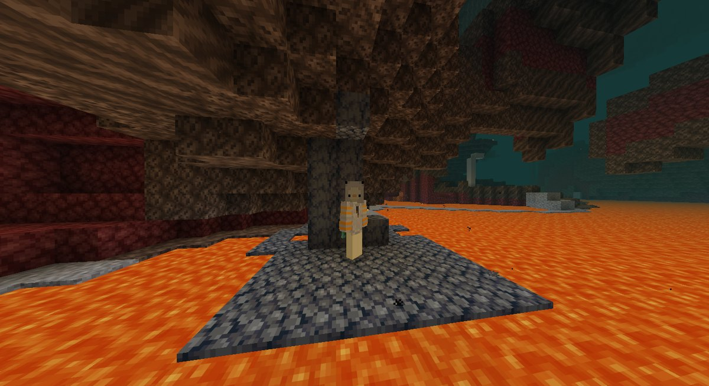
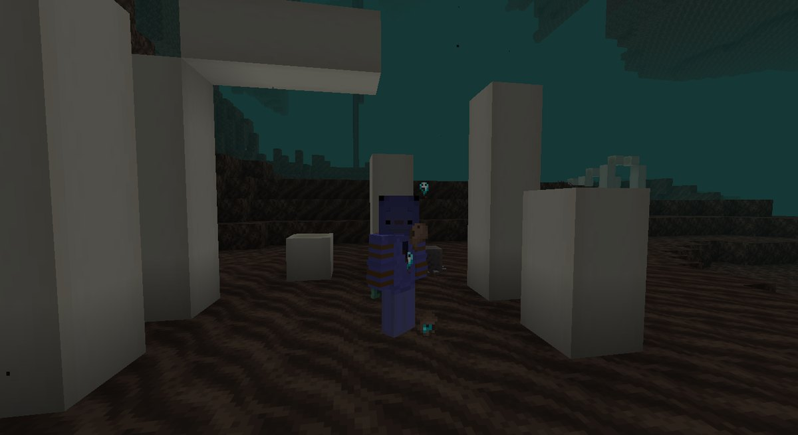
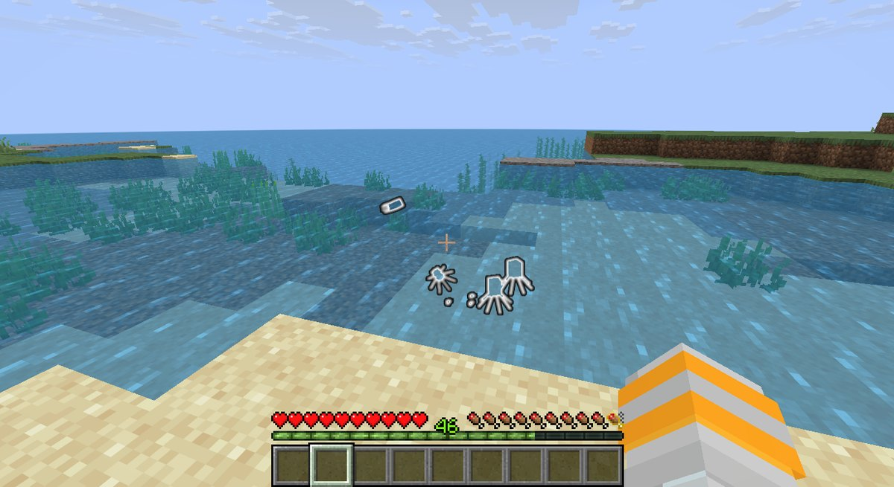
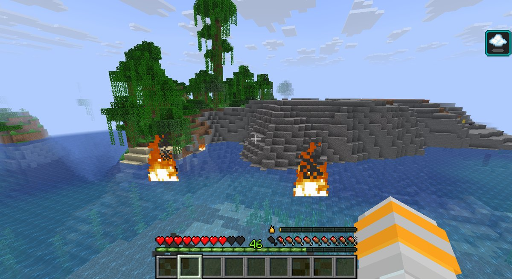

<p align="center"></p>

<h1 align="center">Adapted Origins Legacy</h1>

<p align="center">A modern update to IHasName's "Adapted/Evolving Origins" datapack, built for <a href="https://modrinth.com/mod/origins-legacy">Origins: Legacy</a>.<br>Defeat the Ender Dragon, and your origin evolves.</p>

<p align="center">
  <a href="https://modrinth.com/project/adapted-origins-legacy"></a>
  
  
</p>

<p align="center"><a href="https://modrinth.com/project/adapted-origins-legacy"><strong>Download on Modrinth</strong></a> &nbsp;&middot;&nbsp; <a href="https://github.com/DuckieOverload/Adapted-Origins-Legacy/wiki">Wiki</a> &nbsp;&middot;&nbsp; <a href="https://github.com/DuckieOverload/Adapted-Origins-Legacy/issues">Report a bug</a></p>



## Overview

Adapted Origins Legacy is a modern port of IHasName's "Adapted/Evolved Origins" datapack. I enjoyed the original, but it was broken on modern versions of Minecraft, so I rebuilt it for Origins: Legacy.

Every origin gets an **adapted** form. Defeat the Ender Dragon and your origin evolves: it keeps what made it special and gains new, stronger powers. The pack also adds **three new origins**: the Nevian, the Undying and the Ashen Skeleton.

## How adapting works

1. Pick your origin as usual.
2. Defeat the Ender Dragon.
3. Your origin becomes its adapted version, with upgraded abilities. The table below and the wiki show what changes.

## New origins

| Origin | What it is | Abilities |
|---|---|---|
| **Nevian** | A lizard-based origin with an affinity for deserts and potions | Reptilian Mass (mostly meat, and a dislike of broccoli), Alchemist's Enhancements (potions hit harder, for better or worse), Coldblooded (faster in warm biomes, slower in cold ones), Reckless (only armor without Unbreaking), Nevian's Biology (golden carrots give regeneration) |
| **Undying** | A ghost with a second chance at life | Death's Door (the first time you die, you come back; it recharges over time), Ghostly Aura, Sunlight Vulnerability, Cursed Prison (only cursed armor, or leather), Soul Walker |
| **Ashen Skeleton** | A wither skeleton-based origin that feeds on others to live | Blade of Injury (activate it for a 50% chance to wither enemies), Soul Treads, Leech (food is a quarter as filling, so attack to restore hunger), Necrotic Height (2.5 blocks tall), Heavy (sluggish in water), Netherbound (spawns in the Nether), Withered (immune to fire, poison and wither) |

## Adapted origins

Highlights of each origin's adapted form. The [wiki](https://github.com/DuckieOverload/Adapted-Origins-Legacy/wiki) has the full ability lists.

| Origin | Adapted highlights |
|---|---|
| **Arachnid** | Broodmother (spiders are passive unless you attack them), Kin Eater (immune to hunger and poison; meat is more filling), Poison Fangs (melee hits poison, and you deal more damage to poisoned targets) |
| **Avian** | Tailwind+ (even quicker on foot), Leap of Faith (a short jump into the air), plus Featherweight slow falling and regeneration high above y = 160 |
| **Blazeborn** | Dante's Inferno (while on fire, launch eight fireballs or a fiery nova), Levitate and Ascent (you can fly, sort of), Lava Baths (lava restores you) |
| **Elytrian** | Need for Mobility+ (wear up to iron armor and a diamond helmet), Less Kinetic Damage, Sonic Boom (propel yourself forward) |
| **Enderian** | Eyes of the End (toggle to make every nearby entity glow through walls), Arrow Invulnerability |
| **Feline** | Velvet Paws (your feet make no vibrations), Tailwind, Fish Lover (raw cod and salmon heal you) |
| **Merling** | Reinforced Scales, Neptune's Blessing (Dolphin's Grace while you have Water Breathing), Merling Recovery (the sea heals you over time) |
| **Phantom** | Shadow Riata (speed in darkness), Photoallergic+ (a leather helmet keeps the sun off) |
| **Shulk** | Natural Armor+ (one extra point of armor), Fortified Juggernaut (toggle huge resistance at the cost of speed and sight) |
| **Nevian** | Hardened Scales (your scales resist creepers) in place of Reckless |
| **Undying** | Death's Door+ (come back with even more health), Titanic Spirit (double health), and a leather helmet protects you from the sun |
| **Ashen Skeleton** | Fire Arrows, Hard Bones (milk gives Resistance I for 90 seconds), Blade of Injury+ (Wither II for 8 seconds), Mob Neutrality, Wilting |

## Screenshots

<table>
  <tr>
    <td width="50%"><br><sub>Undying in the Nether</sub></td>
    <td width="50%"><br><sub>Adapted Enderian seeing everything</sub></td>
  </tr>
  <tr>
    <td width="50%"><br><sub>Ashen Skeleton in the Nether</sub></td>
    <td width="50%"><br><sub>Adapted Blazeborn flying and shooting fireballs</sub></td>
  </tr>
</table>

## Installation

1. Install [Fabric](https://fabricmc.net/) and [Origins: Legacy](https://modrinth.com/mod/origins-legacy) for your Minecraft version (1.21.5 to 1.21.11).
2. Download Adapted Origins Legacy from [Modrinth](https://modrinth.com/project/adapted-origins-legacy), or use the `Adapted Origins Legacy` folder in this repository.
3. Add it to a world:
   - **New world:** Create New World &rarr; More &rarr; Data Packs, then drag the pack in.
   - **Existing world:** put it in `.minecraft/saves/<your world>/datapacks/`, then run `/reload` or reopen the world.
4. Pick your origin, then go take on the Ender Dragon.

## What's in this repository

```
Adapted Origins Legacy/        the datapack itself
├── pack.mcmeta                pack metadata
├── pack.png                   pack icon
└── data/
    ├── origins/               base origins and the origin layers
    ├── upgraded/              the adapted (evolved) origins and their powers
    ├── nevian/                the Nevian origin
    ├── roubar/                the Undying origin
    └── ashskel/               the Ashen Skeleton origin
```

## Credits

- **IHasName** made the original Adapted/Evolving Origins datapack. I didn't make the original; this is a port to keep it alive on modern versions. See [his original video](https://www.youtube.com/watch?v=8QVJLXMobu8).
- **Origins: Legacy** by BluSpring, an unofficial port of the Origins mod to newer versions of Minecraft.
- The Mob Neutrality power was made by McMake.

## Bugs and ideas

Found something broken? [Open an issue](https://github.com/DuckieOverload/Adapted-Origins-Legacy/issues). Fair warning: I don't update things very often.

---

Made by [DuckieOverload](https://github.com/DuckieOverload). See my other [Minecraft projects on Modrinth](https://modrinth.com/user/duckieoverload1).
